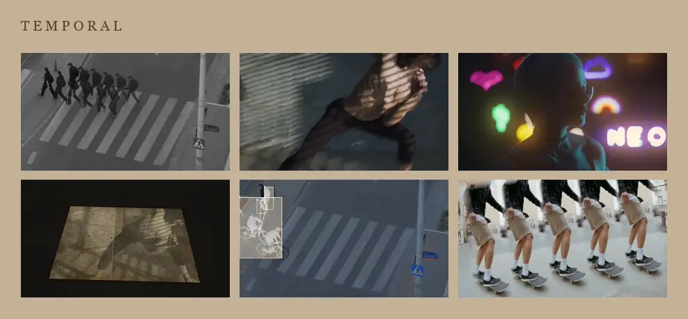

<p align="center"></p>

<h1 align="center">TEMPORAL</h1>

<p align="center">An OpenFX effects suite for DaVinci Resolve Studio on Windows.<br>Effects that work across time, light, glass and paper, on CUDA where Resolve provides it.</p>

<p align="center"></p>

## What it does

Most video effects look at one frame. Many TEMPORAL effects read the frames around it as well: they stack the past over the present, keep light glowing after it has gone, or follow what moves. Others put a physical layer between the camera and the scene: stacked glass, printed paper, a slower shutter.

<table>
<tr>
<td width="50%"><br><b>Echo</b>: earlier frames are laid over the current one as ghosts. Five echoes, twelve frames apart, combined with Darken so each step stays a separate silhouette.</td>
<td width="50%"><br><b>Slow Shutter</b>: a slower virtual camera. Hard Trails keeps the current frame sharp and lets the last moves fade behind it.</td>
</tr>
<tr>
<td><br><b>Temporal Halation</b>: film halation with memory. Highlights from the last frames spread, tint and fade, so lights leave a warm afterglow.</td>
<td><br><b>Print Lab</b>: prints the frame on a simulated sheet (here an aged newspaper) and films it again with a virtual camera.</td>
</tr>
<tr>
<td><br><b>Blob Tracking</b>: finds moving regions, gives each one a steady ID, and draws boxes, links or a matte. Here the boxes invert the image inside them.</td>
<td><br><b>Multi-Optic</b>: up to three virtual glass elements in front of the lens, with dispersion and defocus. Shown with the Facet Echo look.</td>
</tr>
</table>

Clips: Pexels, free to use. The demos are rendered in Resolve with the effects at the settings named above, at 1280 × 720.

## All effects

| Family | Effects |
|---|---|
| Temporal | Time Shift, Slow Shutter, Echo, Stutter, Time Displacement |
| Optics | Prism, Temporal Halation, Diffusion Lab, Refraction Lab, Multi-Optic, Lens Character, Rain Glass |
| Digital | Datamosh, Pixel, CRT / Analog, Geometric, Art Styles, Mosh Styles |
| Physical media | Print Lab |
| Motion & compositing | Camera Motion Lab, Procedural Motion, Motion Tear, Blob Tracking, Double Exposure |


## Install

1. Download `TEMPORAL-<version>-win64.exe` from the releases page and run it. No administrator rights are needed.
2. Restart Resolve. The effects appear under **OpenFX > TEMPORAL** on the Edit, Fusion and Color pages.

The installer copies the plugin to `%LOCALAPPDATA%\Temporal\OpenFX` and adds that folder to your `OFX_PLUGIN_PATH`. To uninstall, use Windows **Settings > Apps > TEMPORAL**.

## Temporal Panel

Each effect has a **Temporal Panel** button in the Inspector. It opens a floating panel with controls grouped and coloured by family, XY pads, angle dials and colour wheels. Edits show in Resolve as you make them, and each animatable control has a keyframe diamond for the playhead position.

On the Edit and Color pages the live refresh needs **Preferences > System > General > External scripting using: Local**.

## Recommended settings for smooth playback

Measured in Resolve Studio on an RTX 3070 Ti with a 1080p timeline and a 4K source ([details](docs/performance/preview.md)).

| Setting | Where | Why |
|---|---|---|
| **CUDA** | Preferences > Memory and GPU > GPU processing mode | Thirteen effects render directly in Resolve's CUDA mode. OpenCL and Metal are not supported. |
| **Half playback resolution** | Playback > Timeline Playback Resolution > Half | Resolve sends the same render request for playback and export, so TEMPORAL cannot lower quality on its own during playback. At Half, 19 of 23 effects keep up with 30 fps, against 10 at Full. Deliver still renders at full resolution. |
| **Optimized or proxy media** | Media Pool > right-click > Generate Optimized Media | Effects that read many neighbouring frames, such as Time Displacement and Blob Tracking, are limited by decoding long-GOP 4K files such as phone or drone H.264/H.265. |
| **Render cache** | Playback > Render Cache > Smart or User | For heavy temporal effects, cache the clip once and play it back in real time. |

Pixel-sized controls such as blur radii look twice as large during Half playback on the Color page. The final render is not affected.

The Cutwright effects (CRT / Analog, Geometric, Art Styles, Mosh Styles) run on CUDA and multithreaded C++. Only if the GPU path is unavailable do they fall back to a local Python process, which then needs NumPy and Pillow. Point `TEMPORAL_FX_PYTHON` at a `python.exe` that has both if needed. `TP_DISABLE_GPU=1` forces the CPU path.

## Build

Requirements: Visual Studio 2022 C++ build tools, CMake, Ninja, Python 3, and optionally the CUDA toolkit.

```powershell
./build.ps1 -Test -OpticStudio
./tools/package.ps1
```

`build.ps1` fetches the pinned OpenFX SDK into `third_party/openfx`, builds both bundles (`TEMPORAL` and `TEMPORAL-Optic`), and runs the test suite. `tools/package.ps1` produces `dist/TEMPORAL-<version>-win64.exe`.

## Layout

- `src/core`: render framework, parameter model, module registry
- `src/modules`: the effects
- `src/gpu`: CUDA kernels and runtime
- `src/ofx`: OpenFX adapter and the Temporal Panel
- `resources`: Python kernels and Fusion settings shipped in the bundle
- `tests`: unit, sweep and CUDA tests, plus benchmarks
- `assets/brand`: logo and icons, generated by `tools/brand.py`
- `docs/media`: the demo loops above

## License

Free to use, including for commercial productions, and everything you render with TEMPORAL is yours. TEMPORAL itself, and any fork or modified version, may not be sold and must stay under the same license with credit to the author. See [LICENSE.md](LICENSE.md).
